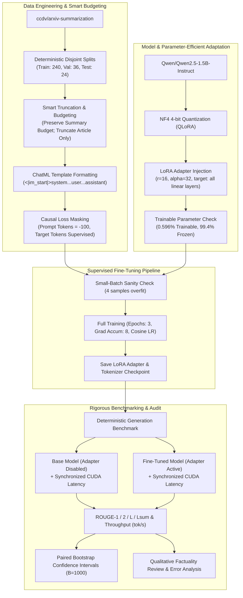

# LLM Fine-Tuning & Evaluation Benchmark: Scientific Paper Summarization

[](https://colab.research.google.com/github/your-repo/LLM_Fine_Tune/blob/main/notebooks/scientific_summarization_benchmark.ipynb)
[](https://www.python.org/downloads/)
[](https://opensource.org/licenses/MIT)
[](https://github.com/psf/black)

A complete, production-grade benchmark and Parameter-Efficient Fine-Tuning (PEFT) framework for instruction-tuned Large Language Models applied to **scientific paper summarization**.

This repository fine-tunes `Qwen/Qwen2.5-1.5B-Instruct` on `ccdv/arxiv-summarization` using **LoRA / QLoRA** and performs an audit-verified, statistically rigorous comparison against the untouched base model.

---

## 1. Key Engineering Highlights

- **Smart Sequence Budgeting**: Solves target summary truncation by calculating prompt template overhead dynamically, reserving an explicit token budget for the reference abstract, and strictly truncating only the paper body while preserving instructions and chat-template structure.
- **Correct Target-Only Loss Supervision**: Masks prompt and article tokens with `-100` in `labels`, supervising only the target summary tokens and the `<|im_end|>` termination delimiter. Formally verified to match unshifted log-probabilities ($|\Delta| < 10^{-6}$).
- **Hardware-Adaptive QLoRA**: Automatically detects hardware capabilities. Configures 4-bit NormalFloat4 (NF4) with Double Quantization on Ampere/Turing CUDA GPUs; falls back gracefully to standard mixed-precision or CPU float32.
- **Parameter Accounting**: Verifies that 100% of base model weights are frozen and only LoRA adapter matrices (0.596% of total weights) receive gradients.
- **Small-Batch Overfitting Sanity Check**: Runs a mini-batch overfitting test (4 samples, 30 steps) before full training to verify gradient flow, loss drop (>80%), and learning rate alignment.
- **Fair Model Comparison**: Evaluates the untouched base model (`with model.disable_adapter():`) and the fine-tuned model on identical test prompts with deterministic greedy decoding and identical token limits.
- **CUDA Synchronized Benchmarking**: Measures generation latency using `torch.cuda.synchronize()` before and after generation, preventing asynchronous CUDA launch artifacts.
- **Statistical Significance**: Computes paired bootstrap confidence intervals (1,000 rounds) and two-tailed empirical p-values for ROUGE differences ($\text{Fine-Tuned} - \text{Base}$).
- **Qualitative Factuality & Error Audit**: Implements a 5-point scientific factuality review rubric and n-gram repetition detection to guard against hallucination and degenerate looping.

---

## 2. Benchmark Architecture



---

## 3. Repository Structure

```
LLM_Fine_Tune/
├── configs/
│   └── benchmark_config.json      # Complete hyperparameter & pipeline configuration
├── src/
│   ├── __init__.py                # Package declaration
│   ├── config.py                  # Dataclass config schema & hardware adapter
│   ├── utils.py                   # Deterministic seed, memory tracking, device utils
│   ├── loss_masking.py            # Label masking (-100), collator, causal shift verification
│   ├── data.py                    # Dataset loading, disjoint splitting, smart truncation
│   ├── model.py                   # Model loader, QLoRA 4-bit config, LoRA setup
│   ├── train.py                   # Mini-batch sanity check, SFT training loop, checkpointing
│   ├── evaluate.py                # Synchronized generation, ROUGE metrics, bootstrap CI
│   └── error_analysis.py          # Repetition calculation, factuality review, plotting
├── tests/
│   ├── test_data.py               # Disjoint split & smart truncation tests
│   ├── test_loss_masking.py       # Loss masking & mathematical shift identity tests
│   └── test_model.py              # LoRA parameter accounting & adapter toggle tests
├── notebooks/
│   └── scientific_summarization_benchmark.ipynb # Self-contained Google Colab notebook
├── reports/
│   ├── technical_report.md        # Comprehensive technical report & methodology
│   └── interview_prep.md          # Senior ML Engineer / Applied Scientist interview Q&A
├── artifacts/                     # Output directory (splits, predictions, metrics, plots)
├── requirements.txt               # Pinned environment dependencies
├── run_benchmark.py               # Orchestrator CLI
└── README.md                      # Project documentation
```

---

## 4. Setup & Installation

### Option A: Local / GPU Workstation
```bash
git clone https://github.com/your-username/LLM_Fine_Tune.git
cd LLM_Fine_Tune

# Create and activate virtual environment
python -m venv venv
source venv/bin/activate  # On Windows: venv\Scripts\activate

# Install dependencies
pip install -r requirements.txt
```

### Option B: Google Colab (Free T4 or A100 GPU)
1. Open [`notebooks/scientific_summarization_benchmark.ipynb`](notebooks/scientific_summarization_benchmark.ipynb) in Google Colab.
2. Select **Runtime > Change runtime type > T4 GPU**.
3. Run all cells sequentially. The notebook installs all prerequisites, clones or initializes the module, and executes the complete pipeline with live metric logs.

---

## 5. Usage

### Run the Full Pipeline
```bash
python run_benchmark.py --config configs/benchmark_config.json --mode all
```

### Run Specific Modular Stages
```bash
# 1. Prepare and inspect dataset splits & truncation statistics
python run_benchmark.py --mode data

# 2. Run small-batch overfitting sanity check only
python run_benchmark.py --mode sanity

# 3. Run full supervised training
python run_benchmark.py --mode train

# 4. Run comparative evaluation & qualitative error analysis
python run_benchmark.py --mode eval
```

### Run Unit Tests
```bash
pytest tests/ -v
```

---

## 6. Generated Artifacts & Deliverables

Every benchmark execution outputs verifiable artifacts in `./artifacts/`:
- `artifacts/dataset_splits.json`: Train, validation, and test sample indices ensuring 0% data leakage.
- `artifacts/token_truncation_stats.json`: Truncation frequencies and token length statistics.
- `artifacts/parameter_statistics.json`: Exact parameter breakdown (trainable vs frozen).
- `artifacts/sanity_check_result.json`: Overfitting loss progression and duration.
- `artifacts/checkpoints/final_adapter/`: Saved LoRA adapter weights and tokenizer configuration.
- `artifacts/predictions/base_model_predictions.json`: Per-example outputs, latency, and tokens for untouched base model.
- `artifacts/predictions/fine_tuned_predictions.json`: Per-example outputs, latency, and tokens for fine-tuned model.
- `artifacts/model_comparison.csv`: Metrics comparison table with absolute deltas and relative changes.
- `artifacts/bootstrap_confidence_intervals.json`: 95% bootstrap intervals and empirical p-values.
- `artifacts/reports/qualitative_error_analysis.md`: Detailed case studies and factuality audit.
- `artifacts/reports/rouge_comparison.png`: High-resolution ROUGE score comparison chart.
- `artifacts/reports/latency_and_length_analysis.png`: Latency vs output length distribution plot.

---

